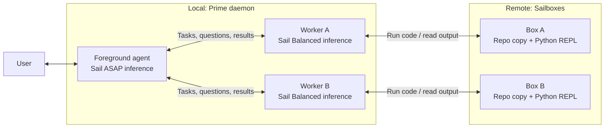

# Prime Agent + SAIL

Background agents on [Sail](https://docs.sailresearch.com), built as a fork of [Prime Agent](https://github.com/PrimeIntellect-ai/prime-agent).

At a high level, the goal is to have one _foreground_ agent which the user converses with, responsible for managing _background_ agents - which are responsible for implementation (eg PRs) à la [Cursor Projects](https://cursor.com/blog/projects).

The background agents:

- run with balanced inference
- run with their own copy of the project, in a Sailbox

The foreground agent, doesn't work on PRs etc itself, instead it
- manages the bg agents:
  - breaks user requests into independent tasks
  - can read worker state and msg them / receive msgs
- maintains a project state, user intent, tasks do[ing|ne] etc 

## How it works



### `rlm.dispatch()` - new RLM primitive 

`rlm.dispatch()` is a new RLM primitive that starts a background worker in its own Sailbox and sets up a repo copy. It spawns a deepseek 4.1 flash subagent on Sail Balanced:

- worker harness / inferences / controller run on the local prime daemon <sup>[1](#note-1)</sup>

- each subagent's REPL / file operations work on **Sailboxes** which:
  - clone the working repo and workers can write PRs to it <sup>[2](#note-2)</sup>
  - autosleep when the agent is "idle"
  - when idled can be awoken by:
    - fg agent messaging the worker
    - cron jobs by the agent itself

- each worker is also an RLM:
  - it can spawn children via `rlm.spawn()` which work on the same box
  - it can message parents / children / siblings

<a name="note-1"></a>
<sup>[1]</sup> "separating the hands and the brain" has many benefits here

<a name="note-2"></a>
<sup>[2]</sup> gh auth using [credential injection](https://docs.sailresearch.com/sailboxes-credentials)

### Worker Context

```text
/workspace/
├── <repository-name>/   cloned from main
└── inputs/
    ├── project_context/   PROJECT.md + project/
    └── <name>/          anything passed as inputs={'<name>': 'path'}
```

- the foreground maintains `PROJECT.md` and detailed notes in `project/`,
  - tracking user intent and dispatched work (both ongoing and completed)
  - shared with workers

- the fg agent can share arbitrary local files with workers too
- (prime agent skills are copied too)

## Demo

https://github.com/user-attachments/assets/0d77f48b-c22a-4eba-bf6c-3d88046c3001

<table>
<tr>
<th width="50%">Crons on remote agents just work :)</th>
<th width="50%">Share files between remote workers and local</th>
</tr>
<tr>
<td width="50%">

https://github.com/user-attachments/assets/95536922-28be-4614-993c-639074e1d43b

</td>
<td width="50%">

<video src="https://github.com/Aditya-Mehta1/prime-agent-sail/raw/main/docs/assets/file-transfer_v1.mp4" controls width="100%"></video>

</td>
</tr>
</table>

## Try it

```bash
npm ci
npm link
```

```bash
cd /path/to/project
prime-agent-sail
```

Needs macOS or Linux, Node 22.8+, and Sail API key
